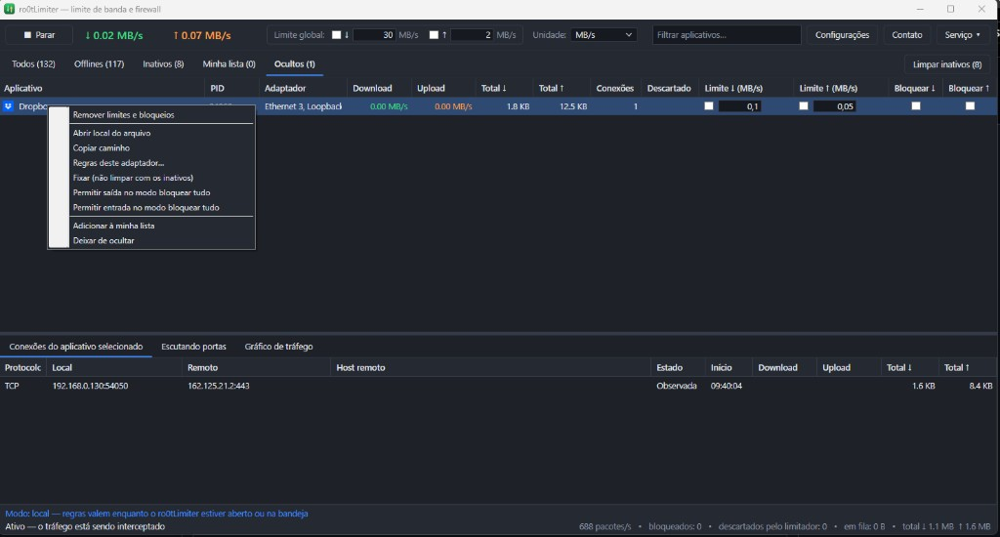

# ro0tLimiter

Limitador de banda e firewall por aplicativo para Windows de 64 bits.



Cada programa tem limite de download e de upload, bloqueio de entrada e de saída, e a taxa que realmente passou pelo filtro. Há um limite global, regras por adaptador de rede, abas para programas offline, inativos, favoritos e ocultos, e uma lista das portas em escuta. As regras podem ser aplicadas por um serviço do Windows desde a inicialização.

O ícone da bandeja fica verde com o controle ativo e vermelho quando ele está parado.

## Requisitos

- Windows 10 ou 11, 64 bits
- Permissão de administrador
- .NET 8 Desktop Runtime, que o instalador baixa da Microsoft se ainda não estiver presente

## Instalação

Cada versão publicada tem dois downloads na [página de releases](https://github.com/zazuts/ro0tLimiter/releases): `ro0tLimiter-Setup-<versão>.exe` (instalador) e `ro0tLimiter-<versão>-win-x64.zip` (pasta pronta, sem instalador). O instalador está em inglês. Ele copia o programa, a biblioteca de captura e o driver, e baixa o runtime do .NET 8 quando falta. As versões anteriores continuam na mesma página.

## O que o programa faz

- Limite de download e de upload por programa, em KB/s ou MB/s, e um limite global
- Bloqueio de entrada e de saída por programa
- Bloqueio ou limite de um programa em um adaptador de rede
- Abas Todos, Offlines, Inativos, Minha lista e Ocultos, com ordenação por nome
- Portas em escuta, com processo, protocolo, endereço, porta, PID e caminho
- Cores de linha para arquivo ausente, regra especial, WSL, programa fixado, aplicativo do sistema, assinatura digital e tráfego em andamento
- Bloqueio, em um clique, de listas fixas de telemetria, atualização e alguns serviços da Microsoft
- Listas de portas, endereços, executáveis, domínios, expressões regulares e listas baixadas
- Registro opcional de pacotes descartados, conexões e depuração do próprio programa
- Cópia dos bloqueios para o Firewall do Windows. Limites de velocidade, domínios e expressões regulares permanecem só no ro0tLimiter
- Idioma em português (Brasil) ou inglês (Estados Unidos)
- Ao remover o serviço: manter as configurações ou apagar todos os dados

## Compilar

```bat
dotnet build -c Release
```

O resultado fica em `bin\Release\net8.0-windows\ro0tLimiter.exe`. `WinDivert.dll`, `WinDivert64.sys` e `ThirdParty-LICENSE.txt` são copiados para a mesma pasta.

O instalador é gerado com Inno Setup a partir de `installer\ro0tLimiter.iss`.

## Licença

O ro0tLimiter é distribuído sob a GNU Lesser General Public License versão 3. Veja `LICENSE` e `NOTICE`.

A captura de pacotes usa a WinDivert 2.2.2, de Basil. A WinDivert é oferecida, à escolha de quem distribui, sob a GNU LGPL versão 3 ou a GNU GPL versão 2. Este projeto escolhe a **LGPL versão 3**: a biblioteca e o driver vão sem modificação, em arquivos separados, e o programa os carrega em tempo de execução. A GPL versão 2 também seria uma escolha válida e exigiria que o programa combinado inteiro fosse distribuído só sob a GPL versão 2. A LGPL versão 3 é a licença pensada para este tipo de uso.

O texto integral que acompanha a WinDivert, com LGPL v3, GPL v3 e GPL v2, está em `third_party/WinDivert/LICENSE` e é instalado ao lado do executável como `ThirdParty-LICENSE.txt`. A janela Contato mostra o aviso enquanto o programa está aberto.

## Contato

Email para contato: [ro0t@hotmail.it](mailto:ro0t@hotmail.it)

Doação de US$ 3: <https://www.paypal.com/donate/?hosted_button_id=QLPEHGUTPCLXJ>

---

# ro0tLimiter

Per-application bandwidth limiter and firewall for 64-bit Windows.

Each program has a download limit, an upload limit, inbound and outbound blocks, and the rate that actually passed through the filter. There is a global limit, per-adapter rules, tabs for offline, inactive, favorite and hidden programs, and a list of listening ports. Rules can be enforced by a Windows service from boot.

The tray icon is green while filtering is running and red when it is stopped.

## Requirements

- 64-bit Windows 10 or 11
- Administrator permission
- The .NET 8 Desktop Runtime, which the setup downloads from Microsoft when it is missing

## Install

Each published version has two downloads on the [releases page](https://github.com/zazuts/ro0tLimiter/releases): `ro0tLimiter-Setup-<version>.exe` (setup) and `ro0tLimiter-<version>-win-x64.zip` (a ready folder, without the setup). The setup is in English. It copies the program, the capture library and the driver, and downloads the .NET 8 runtime when needed. Older versions stay on the same page.

## License

ro0tLimiter is distributed under the GNU Lesser General Public License version 3. See `LICENSE` and `NOTICE`.

Packet capture uses WinDivert 2.2.2 by Basil. WinDivert is offered, at the distributor's choice, under the GNU LGPL version 3 or the GNU GPL version 2. This project elects the **LGPL version 3**: the library and the driver ship unmodified as separate files, and the program loads them at run time. GPL version 2 would also be a valid choice and would require the entire combined program to be distributed under GPL version 2 only. LGPL version 3 is the license written for this kind of use.

The full text shipped with WinDivert, including the LGPL v3, GPL v3 and GPL v2, is in `third_party/WinDivert/LICENSE` and is installed beside the executable as `ThirdParty-LICENSE.txt`. The Contact window shows the notice while the program is open.

## Contact

Contact email: [ro0t@hotmail.it](mailto:ro0t@hotmail.it)

US$ 1 donation: <https://www.paypal.com/donate/?hosted_button_id=QLPEHGUTPCLXJ>
